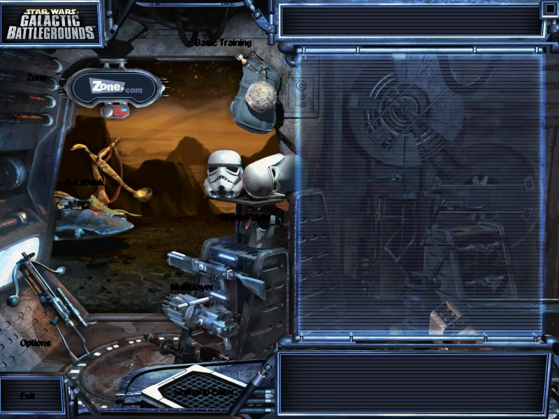

# Star Wars: Galactic Battlegrounds — Static Recompilation

Static recompilation of **Star Wars: Galactic Battlegrounds** (LucasArts and
Ensemble Studios, 2001; the Age of Empires II Genie engine) from its shipping
Win32 executable, `Battlegrounds.exe` v1.1, to native C that runs on modern
Windows. No emulator: the game's own code, recompiled, with a software
DirectDraw so the desktop's display mode never changes.

Built on the [pcrecomp](https://github.com/sp00nznet/pcrecomp) toolchain, on
its `main` branch, and following
its house style: layout, command line, conformance harness, headless mode.

## Getting Started

You need **your own copy**: the US release on two discs (disc 1 installs,
disc 2 is the play disc), and LucasArts' v1.1 update `BGUpdate1_1.exe` if
your install is v1.0. Nothing from the game is in this repository or
downloaded for you; everything is built on your machine from your copy.
The CD check passes with disc 2 in the drive or your disc 2 image mounted.

### The setup scripts

1. Install the game from disc 1 the usual way (or copy an installed `Game`
   folder from another PC).
2. Download this repository (the green **Code** button, then **Download
   ZIP**) and unzip it somewhere with 8 GB free.
3. Windows: double-click **`Setup.cmd`**. Linux (Debian, Ubuntu, WSL2):
   run **`./setup.sh`**; it takes the Steam Saga release too (unwrapped,
   no disc 2 needed) and ends with `./play.sh`. macOS: by hand
   ([docs/linux-macos.md](docs/linux-macos.md)).
4. Play with **`Galactic Battlegrounds`** in that folder.

The script checks for Python 3.10+, `capstone`, the pcrecomp toolkit (cloned
beside this folder if it is missing) and
Visual Studio 2022's C++ tools, and asks before installing any of them. It
asks where the installed `Game` folder, disc 2 (a drive, `.iso` or `.cue`) and `BGUpdate1_1.exe` are (it
looks first; `-GameDir`, `-PlayDisc`, `-PatchExe` and `-Yes` skip the
questions), then catalogs, lifts and builds. The build is 5.4M lines of C and
takes 30 minutes or more. A rerun skips finished steps, and the details go to
`setup.log`. Building by hand and the command line are in
**[docs/building.md](docs/building.md)**.

## Status

**v0.1.0-dev, alpha.** The base game and Clone Campaigns play, recompiled
throughout: skirmishes to a victory or a defeat, saved and loaded, the first
campaign missions, the films, LAN games between two recomps, at any
resolution. Most of it is checked by headless runs driven by scripted mouse
and keys ([docs/testing.md](docs/testing.md)). Windows plays; Linux plays
natively on pcrecomp's `win32hle`; macOS is not done.

| Stage | State |
|---|---|
| The build | `Battlegrounds.exe` **v1.1** (LucasArts' `BGUpdate1_1.exe` over the US CD), PE stamp `0x3C03FD69` (2001-11-28), MSVC6 C++, DirectDraw 8-bit, DirectPlay, no relocations, no copy protection. Other builds are refused by `run_lift.py` |
| Function catalog (`disasm32`, pcrecomp) | 20,802 functions, 95.3% of the code range, plus 63 seeds in `run_lift.py`: the `THIS_COD` blitter's jump tables, and 19 entries reached only through a pointer in data (`tools/code_ptr_seeds.py`, [docs/lifting.md](docs/lifting.md#pointers-the-catalog-dropped)) |
| Lift (`run_lift.py --all`) | 20,820 functions, 0 lift errors, 5.4M lines of C in 53 files. An indirect call to an address the lift lacks stops the run there and names it (exit 5) |
| Exception handling | 702 C++ frames (488 of the 489 with a frame are frame-pointer-omitted) and 14 `__try` frames in the CRT, lifted with landing pads by pcrecomp's MSVC EH support ([docs/exceptions.md](docs/exceptions.md)) |
| Host (`swgbrecomp.exe`, 32-bit, pcrecomp `native32`) | 258 imports: most go to the real Windows DLLs, the rest are shimmed. DirectDraw is a software one (`softdd`), DirectPlay the host's own |
| Game data | `genie.dat` and the `.drs` archives load; the game's deflate decoder is the host's ([docs/lifting.md](docs/lifting.md)) |
| Menus | **run**: drawn as the original, text fields with a caret, hover help, Options |
| Single Player / skirmish | **plays to the end**: defeats by Hardest computers with the score screen, victories (one by combat: Simon the Killer Ewok's waves razing the base), a 7-computer game saved, loaded and played on; 1 to 7 computers, Tiny to Giant maps |
| Campaign | **plays**: OOM-9's missions 1-5 won in a row (briefings, triggers, score screens, Scenario Menu); the first missions of three campaigns soaked. Later missions, and the other campaigns past mission 1: not tried |
| Clone Campaigns | **plays** as a second lift and host (`run_lift.py --build cc`, `swgbrecomp_cc.exe`, the same runtime): Steam's `battlegrounds_x1.exe` unwrapped, 21,069 functions, 0 lift errors, `/O1`; its menus, `_x1` data, films, `--res`, skirmishes with the Republic and the Confederacy and both Episode II campaigns' first missions, 1.9 game-hours of soak with no fault ([docs/lifting.md](docs/lifting.md#clone-campaigns)) |
| Soak | about 11 game-hours of the base game headless (skirmishes, a monkey, campaigns, games to the end): no fault since softdd's surface slack, no unresolved call ([ROADMAP.md](ROADMAP.md#stability--coverage)) |
| Resolutions | the game's 800x600, 1024x768 and 1280x1024 in game; **any size** with `--res WxH` or `--res desktop` (widescreen: the map fills the screen, the interface centred), checked from 1024x600 to 3440x1440 ([docs/building.md](docs/building.md)) |
| Presentation | aspect-correct letterbox, filters `sharp`, `smooth`, `nearest`, `integer` (Alt+F12), borderless fullscreen (Alt+Enter) with no display-mode change; `--present d3d11` opt-in |
| Frame rate and CPU | `--fps N`, the display's refresh by default (game speed unchanged); a skirmish at 800x600 takes 18% of a core (was 97%), the menus 10% ([docs/framerate.md](docs/framerate.md), [docs/performance.md](docs/performance.md)) |
| Sound | DirectSound and the mixer are the real ones; test runs are muted. CD music (Steam's Ogg tracks): not yet |
| Films | **play**: Indeo 5 decoded by FFmpeg (on `PATH`), with sound, skippable; tested with the Saga's Clone Campaigns logo and intro ([docs/movies.md](docs/movies.md)) |
| Multiplayer (LAN) | **plays** between two recomps: a DirectPlay 4 of the host's own (TCP sessions, UDP discovery on 2300); 25 minutes of the base game and 20 of Clone Campaigns with every sync checkpoint equal (`tools/mp_pair.py`). One machine over loopback; two real machines not tried yet ([docs/multiplayer.md](docs/multiplayer.md)) |
| Headless mode | `--headless --record out.mp4`: a private desktop (pcrecomp `native32_headless`), nothing on the user's screens, frames piped to ffmpeg; muted |
| Tests | `tools/test.py --level unit`, `smoke`, `functional`, `soak`, `real`: the conformance harness (**5/5** milestones: boot, `genie.dat` inflated, 800x600x8 with 100 frames, the main menu, the Exit button), menu and skirmish shots, the resolutions, films, saves and loads, frame-rate figures, soaks ([docs/testing.md](docs/testing.md)) |
| Setup.cmd | tested from a fresh clone (2026-11-12): catalog, lift, the full build and the shortcut; the conformance harness 5/5 on that build |
| Linux | **runs** natively on pcrecomp's `win32hle` (no Wine): `./setup.sh` from a fresh clone in WSL2 Ubuntu 24.04 (2026-11-26): tools, the Steam copy, catalog, lift, build, `play.sh`; `tools/test.py` there ([docs/linux-macos.md](docs/linux-macos.md)) |
| macOS | designed (`build-macos.sh`), untried: needs a Mac |

## Screenshots

Real output of `swgbrecomp.exe --run --headless`, recompiled code throughout:

| | |
|---|---|
|  |  |

## Documentation

- [docs/building.md](docs/building.md): building by hand, the v1.1 update, the command line, build options
- [docs/testing.md](docs/testing.md): `tools/test.py` and its levels, the conformance harness, the scripted skirmish, soaks
- [docs/lifting.md](docs/lifting.md): lifting `Battlegrounds.exe` and Clone Campaigns' exe, every wall so far and its fix
- [docs/exceptions.md](docs/exceptions.md): the game's C++ and SEH exception frames in the lift
- [docs/framerate.md](docs/framerate.md): how often the game draws and simulates, `--fps N`
- [docs/performance.md](docs/performance.md): the profiler, where the time goes, and what was made faster
- [docs/movies.md](docs/movies.md): the films, decoded by FFmpeg into softdd's frames
- [docs/multiplayer.md](docs/multiplayer.md): LAN games, the host's own DirectPlay, keeping two games in sync
- [docs/linux-macos.md](docs/linux-macos.md): the native Linux (later macOS) host on win32hle, and building it; [docs/linux-bringup.md](docs/linux-bringup.md), the bring-up checklist
- [docs/parallel-work.md](docs/parallel-work.md): several worktrees at once on one machine, and what they share
- [ROADMAP.md](ROADMAP.md), [CHANGELOG.md](CHANGELOG.md), [CONTRIBUTING.md](CONTRIBUTING.md)

## Contributors

See **[CONTRIBUTORS.md](CONTRIBUTORS.md)** for who did what. Thank you, all of
you.

## License

MIT for this repository's own code ([LICENSE](LICENSE)); miniz is MIT
([NOTICE.md](NOTICE.md)). Star Wars: Galactic Battlegrounds is © LucasArts
and Lucasfilm Ltd.; none of its files, and nothing generated from them, is in
this repository.
