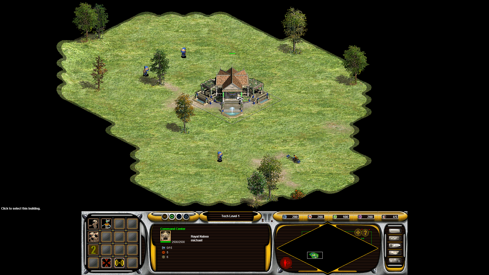

# Building and the command line

`Setup.cmd` (`tools/setup.ps1`) runs exactly the steps below, skipping the ones
already done, and logs everything to `setup.log`. It clones pcrecomp main if it is not beside this folder; main
carries the toolkit work this game needs (MSVC `__try/__except`,
frame-pointer-omitted C++ frames, throws from a statically linked CRT,
`VirtualQuery` on lifted images, the headless desktop).

Linux and macOS: not yet playable. A native host on pcrecomp's `win32hle`
(no Wine) is designed and scaffolded: `src/linux`, `cmake/native.cmake`,
`build-linux.sh` and `build-macos.sh`. [linux-macos.md](linux-macos.md) has
the design, the gaps, the build steps and the state. `setup.sh` still stops.

## Step by step

Prerequisites: Windows 10 or 11; Python 3.10+ (`py -3 --version` should say
`Python 3.1x`; if `python` opens the Microsoft Store, that is the Store alias:
use `py -3` or turn the alias off in Settings); `py -3 -m pip install
capstone`; Visual Studio 2022 or its Build Tools with "Desktop development
with C++" (CMake and Ninja come with it); ffmpeg on `PATH` for `--record`
and the films ([movies.md](movies.md)).

1. Fetch the toolkit beside this folder:
   ```
   git clone https://github.com/sp00nznet/pcrecomp ..\pcrecomp
   ```
2. Copy the installed `Game` folder to `game\` (it has `Battlegrounds.exe`
   and `Data\GENIE.DAT`). To play, put disc 2 in the drive or mount its image
   (double-click the `.iso`; a `.cue`/`.bin` becomes one with
   `py -3 tools\cue2iso.py disc2.cue disc2.iso`). `CD_DRIVE=E` or `--cd E`
   names the drive if there is more than one.
3. If `game\Battlegrounds.exe` is v1.0, apply the update without running it:
   ```
   py -3 tools\bgupdate.py path\to\BGUpdate1_1.exe work\patch
   copy work\patch\Eng\Game\Battlegrounds.exe game\
   copy work\patch\Common\Game\Data\GENIE.DAT game\Data\
   ```
   Expected: `unpacked the v1.1 update into work\patch`.
4. `copy game\Battlegrounds.exe work\`, then catalog it (about ten minutes):
   ```
   py -3 ..\pcrecomp\tools\disasm\disasm32.py work\Battlegrounds.exe -o work\functions.json
   ```
   Expected, at the end: `Functions: 14272` and `Wrote work/functions.json`.
5. Lift it:
   ```
   py -3 run_lift.py --all
   ```
   Expected: `lifted 14273   not-lifted stubs 0   errors 0` and about 4.0M
   lines of C in `src\recomp\gen\`.
6. Build it (30 minutes or more on one machine): `build.cmd`. Expected, at
   the end: `Linking C executable swgbrecomp.exe`.
7. Check it without starting the game: `build\swgbrecomp.exe` maps and binds
   the image and prints `(dry run: image mapped and bound; ...)`.
8. Run: `build\swgbrecomp.exe --run`.

Trip-ups: a different build of `Battlegrounds.exe` is refused by `run_lift.py`
by its PE timestamp; a pcrecomp checkout on `main` lacks the EH support
(`AttributeError: module 'eh32' has no attribute 'frame'`).

## The command line

```
build\swgbrecomp.exe --run                                    windowed, with sound
build\swgbrecomp.exe --run --headless --record out.mp4        no window, record the frames
build\swgbrecomp.exe --run --headless --shot 20 menu.bmp      save the frame after 20 s
build\swgbrecomp.exe --run --keys "10:move:330:240,11:click:330:240"   scripted mouse and keys
build\swgbrecomp.exe --run --headless --watchdog 60 --files   stop after 60 s, log every file opened
build\swgbrecomp.exe --run --fps 60                           60 frames a second in game (default: the refresh)
build\swgbrecomp.exe --run --fps off                          the game's own rate: ~900 a second, a whole core
build\swgbrecomp.exe --run --headless --fps-log               frames, game clock, steps a second
build\swgbrecomp.exe --run --headless --profile p.txt         where the game thread's time goes (performance.md)
build\swgbrecomp.exe --run --films "<Steam>\Game"            films the game cannot find, from there
build\swgbrecomp.exe --run --fullscreen --filter integer      borderless fullscreen, whole-number scaling
py -3 tools\conformance.py                                    the milestones, PASS/FAIL
build\swgbrecomp.exe --run --mp-join 192.168.1.7             multiplayer: also look for games there (docs/multiplayer.md)
```

### The picture: scaling, fullscreen, pacing

The game draws a fixed frame (800x600, 1024x768, 1280x1024: always 4:3); the
window can be any shape. The frame is fitted into the client area with its
aspect kept and black bars, and the mouse is mapped through that same
rectangle (a click in a bar lands on the nearest edge of the picture).

| Flag | Hotkey | What |
|---|---|---|
| `--filter sharp\|smooth\|nearest\|integer` | `Alt+F12` cycles | `sharp` (default): nearest inside a texel, a one-pixel blend at its edges, so no shimmer and no blur at fractional scales. `smooth`: bilinear. `nearest`: nearest neighbour at any size (uneven pixels at odd scales). `integer`: nearest, whole multiples only (bars around, falls back to a fit when the window is smaller than the frame). The window title shows the filter. |
| `--fullscreen` | `Alt+Enter` toggles | A borderless window the size of the monitor the window is on. The desktop's display mode is never changed, so Alt+Tab and other monitors behave as for any window. |
| `--scale N` | | The window starts at N times the game's mode (default: 85% of the screen height). Resize it freely after that. |
| `--refresh HZ` | | Pace frames to HZ instead of the monitor's refresh rate. |
| `--present gdi\|d3d11` | | How the picture reaches the window: GDI (default) or a Direct3D 11 flip-model swap chain that scales on the GPU (falls back to GDI if it cannot start); [performance.md](performance.md). |
| `--present-log` | | Once a second on stderr: presents, frames shown, the refresh rate and filter, and how many frames the timer showed (held back, window damage, a text field up). |

The game presents far more often than a display refreshes (every
`Unlock`/`ReleaseDC` of a primary without a back buffer: tens of thousands a
second while loading, a handful in an idle menu). A frame is drawn when a
refresh interval has passed since the last one; otherwise it is held, and a
one-shot timer draws the latest after the interval, so the last frame before
the game goes quiet is never lost. `--shot`, `--record` (30 fps by the wall
clock) and `--frames` still see every frame they need, and the game's text
fields are composed into the frame that is drawn.

The mouse and the map's edge scrolling follow the letterbox: the game scrolls
when the cursor is within a few pixels of its window's edge, so the game
window's rectangle is reported as the game's own `0,0,W,H`, and the cursor
(clamped to the picture) reaches `0` and `W-1` at the window's or monitor's
edge on all four sides, in any window shape, fullscreen and at any `--res`.
The bars count as the edge. While another window is active the game sees the
cursor in the middle of its picture (no scrolling), and in fullscreen the
cursor is confined to the window while the game is active. The game's own
cursor is restored when the pointer comes back from another window. Fullscreen
survives the game's own window changes at a mode change (Standard Game
start, back to the menus).

The game sees its window as it saw a real fullscreen mode: at 0,0 and exactly
the mode's size (`GetWindowRect` and `GetClientRect`), and its own
`MoveWindow` and `SetWindowPos` of it do not move or size it. Windowed, the
window is yours: at a mode change it keeps its height and takes the new
mode's shape (1280 x 1024 is 5:4), unless you have sized it yourself, when
it stays as you left it.

For scripted tests (`--keys`, see testing.md), all headless: the cursor is a
virtual one, read back by the game as a real cursor is (screen, client,
letterbox, game pixels). `size:W:H` resizes the window's client area,
`wshot=FILE` writes the window as it would be drawn (bars and all, any filter),
`wmove:X:Y` and `wclick:X:Y` take window pixels, each a number or a place
(`L R C`, `T B C`, `PL PR PT PB` for the picture's edges, `BL BR BT BB` for the
middle of a bar, with an offset: `wmove:R:C`, `wmove:PL+60:C`), `alt+enter` and
`alt+f12` press the hotkeys, `setcursor` has the pointer come back into the
window (the game's cursor must survive), and `--keys @FILE` reads the script
from a file, a step to a line. `ldown:X:Y` and `lup:X:Y` press the left button
and release it, with any `move:` steps between them sent as a drag (the
game's box select). `ctrl+KEY` and `shift+KEY` hold the modifier around the
key, so the game's `GetKeyState` sees it (`ctrl+1` makes a control group).
`--keys-live FILE` runs steps appended to FILE while the game runs (`0:what`,
one a line), as they are read: a controller can look at a shot and answer it
(`tools/soak.py --mode fight`).

`--args "..."` passes switches to the game itself; `--game`, `--cd` and
`--exe` point at other folders; `--films DIR` is where the films are when
neither the game folder's `avi\` nor disc 2 has them ([movies.md](movies.md)).
`NATIVE32_TRACE_EH=1` logs every guest exception and where it lands.
`--fps N` and `--fps-log` are in [framerate.md](framerate.md); `--profile` and
what costs what in [performance.md](performance.md).

### Any resolution: `--res`

```
build\swgbrecomp.exe --run --res 1920x1080     the 1280 x 1024 Screen Size becomes 1920 x 1080
build\swgbrecomp.exe --run --res desktop       ... the desktop's size
```

The game's third Screen Size (Options) becomes
the size given, and the Options dialog names it ("1920 x 1080"). Choose it
once: the game keeps the choice in the registry as 1280, so a later run
without `--res` plays at 1280 x 1024. 800 x 600 and 1024 x 768 are
unchanged, and so are the menus, which are always 800 x 600. The width is
rounded down to a multiple of 4 (1366 becomes 1364); sizes from 800 x 600 to
4096 x 4096.

In a game, the interface is laid out at the largest of the game's own
sizes that fits (1280 x 1024 from 1280 wide and 720 high, else
1024 x 768, else 800 x 600): its art and panels sit at the bottom,
centred, with black at the sides, and the map view takes all the rest of
the screen. Dialogs centre on the whole screen. Tested at 1024x600,
1280x720, 1366x768, 1600x900, 1920x1080, 2560x1440 and 3440x1440:
selection, the command buttons, the minimap, scrolling at the right edge,
the menu and its dialogs, switching to 1024 x 768 from the in-game
Options, and quitting to the menus and playing again.



How it works is in `src/runtime/widescreen.c`. In short: the game's
virtual `set_screen_size` call (and the game screen's own resize, draw
and paint methods) are indirect calls, so the host takes them over
(`recomp_lookup_manual`) and lays the screen out at the base size before
moving the panels. `SWGB_RES_DUMP=FILE` writes the game screen's panel
tree after each layout. `SWGB_RES_TRACE=FILE` logs every new indirect
call, with its target, caller, vtable and arguments, from the first mode
change on; use it to find more of them.

## Build options

`build.cmd` configures CMake with Ninja for 32-bit MSVC and builds
`build\swgbrecomp.exe`. `-DGEN_OPT=/Od` (in `CMAKE_ARGS`) compiles the
generated C unoptimized, much faster; the default is `/O1`. On a
[recomp-netlab](https://github.com/sp00nznet/recomp-netlab) farm:
`netlab build swgb-recomp` (recipe `projects/swgb-recomp.env`, `/Od`), which
lands the build in `build-farm\`.

Layout: `run_lift.py` (lift driver), `src/runtime/` (host, `softdd`
DirectDraw, `present` for scaling, fullscreen and pacing, the deflate decoder), `tools/` (setup, the update unpacker, the
conformance harness), `third_party/miniz` (MIT, see `NOTICE`), and the
gitignored `game/`, `cd/`, `work/` and `src/recomp/gen/`.

## Clone Campaigns

The expansion is a second lift and a second host, `swgbrecomp_cc.exe`,
from Steam's install (its `Game` folder has the `_x1` data and
`battlegrounds_x1.exe`):

```
py -3 tools\steamstub_swgb.py game\battlegrounds_x1.exe work\battlegrounds_x1.exe
py -3 ..\pcrecomp\tools\disasm\disasm32.py work\battlegrounds_x1.exe -o work\functions_x1.json
py -3 run_lift.py --build cc --all
build.cmd
build\swgbrecomp_cc.exe --run
```

Expected: `Functions: 21057` (about two minutes), then `lifted 21069
not-lifted stubs 0   errors 0` and 5.5M lines of C in `src\recomp\gen_cc\`.
`build.cmd` builds `swgbrecomp_cc.exe` beside `swgbrecomp.exe` whenever
`src\recomp\gen_cc` has a lift in it. Its default `--exe` is
`work\battlegrounds_x1.exe`. Lift `battlegrounds_x1.exe`, not
`battlegrounds_cc.exe`: that one is the same build with a community
widescreen mod in it, and `run_lift.py` refuses it ([lifting.md](lifting.md#clone-campaigns)).

It is built as the base game is: `GEN_OPT` (`/O1`), and `GEN_HOT_OPT`
(`/O2`) for `CC_GEN_HOT_FILES`, the seven files the base game's four hot
ones became in x1. The full build took 25 minutes here: 11 for 52 files at
`-j 6`, then 14 for `recomp_0039.c` alone, whose compiler peaks near 4 GB
of commit (the base game's own large files are alike). Windows without a
pagefile limits commit to the size of RAM whatever is free, so on a busy
machine a few compilers at once fail with `C1002: compiler is out of heap
space`: build with fewer jobs (`build.cmd -j 4`, then `-j 1` for what is
left). Do not fall back to `/Od` to play: its frames are about eight times
larger, and the sprite decoder's nesting then overflows the 16 MB stack
([lifting.md](lifting.md#clone-campaigns)).

To play it, as the base game but with its own host and exe, and the game
folder for its films (`xlogo1.avi`, `xintro.avi` are at the top of Steam's
`Game`):

```
build\swgbrecomp_cc.exe --run --sound --exe work\battlegrounds_x1.exe --game game --films game --res desktop --fullscreen
```
